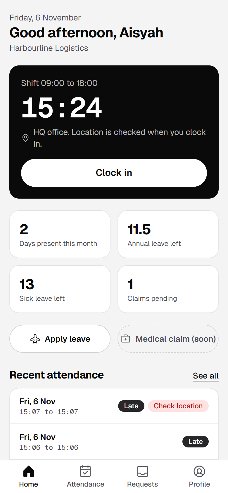
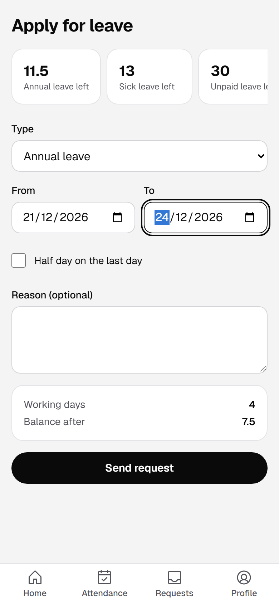
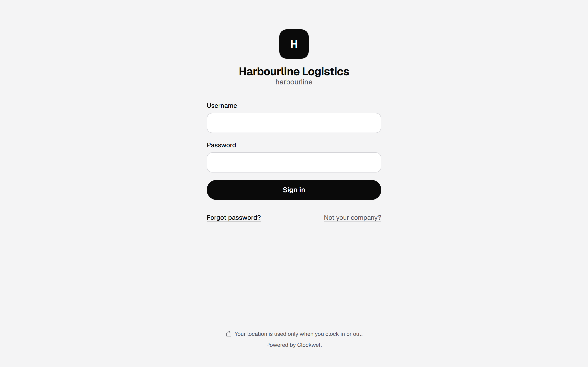
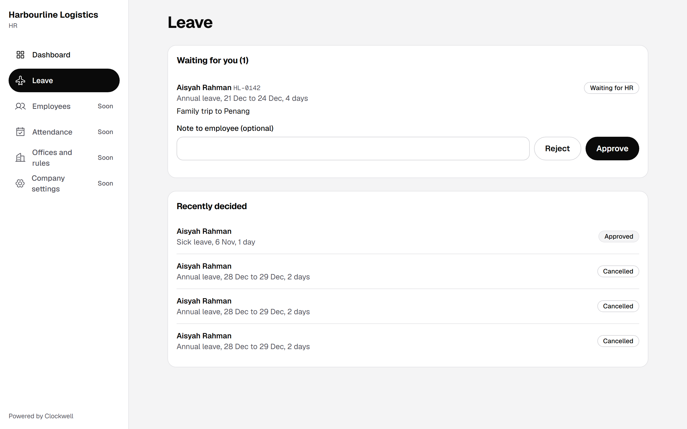

<div align="center">

# Clockwell

### Attendance, leave and claims that run themselves.

Staff clock in with a selfie and their location in under ten seconds.
HR sees who is in, approves requests and fixes mistakes from a phone.
Owners get honest records without buying a single machine.

**[Live pilot: clockwell-rose.vercel.app](https://clockwell-rose.vercel.app)** · Built for Singapore and Malaysia · Works on any phone

`Status: pilot · Phases 1 to 4 complete · Taking on pilot companies`

</div>

<p align="center">
  
  &nbsp;&nbsp;
  
  &nbsp;&nbsp;
  
</p>

> **This is a pilot.** The live app is running with our first companies. While we roll out
> improvements it may sometimes show a short **"Maintenance in progress"** notice. Nothing is lost:
> clock-ins made during maintenance are kept safely on the phone and sent automatically when it ends.

---

## The problem

Most small and medium companies still run attendance on paper sheets, punch cards, WhatsApp
messages and spreadsheets. Leave lives in someone's inbox. Medical claims sit in a folder until
month end. Every week HR loses hours chasing people, owners argue about who was really late, and
nobody is quite sure the company meets the PDPA.

Big HR suites fix this, but they are priced, sized and configured for big companies.
**A 20 to 500 person company needs something it can switch on in a day. That is Clockwell.**

## Why companies choose Clockwell

| | |
|---|---|
| **No hardware, no install** | No fingerprint scanners or punch-card machines. Staff open a link on the phone they already have and add it to the home screen like an app. |
| **Records you can trust** | Every clock-in uses the server's time, a selfie and the GPS position. "My phone clock was wrong" is no longer an argument. |
| **Works on site, not just in the office** | Each site has its own clock-in boundary. Construction crews, field teams and branches all clock in where they actually work. Outside every site? Clock-in is blocked, and HR decides how strict that is. |
| **Your rules, not ours** | HR sets the late leeway (say, 10 minutes), the boundary per site, a GPS allowance for weak signals, shift times and home days, for the company, a site or one person. |
| **Works without signal** | No connection on a basement site? The clock-in is saved on the phone and sent the moment the signal returns. |
| **HR from a phone** | Alerts for late clock-ins, missed clock-outs and requests waiting. Approve leave, time fixes and claims with one tap, wherever you are. |
| **Private by design** | Location is read only at clock-in and clock-out. No background tracking, no face templates, no biometric data. Selfies are deleted automatically after the period you choose. |
| **Built for audits and disputes** | Original times are never edited. Every fix is stored separately with a reason, and every important action is logged. |
| **Your data is yours** | Export everything as spreadsheets any time. Each company's data is walled off from every other company's, and proven so by automated tests. |

## What it does

### For staff
- **Clock in and out** with a selfie and location. The app shows the nearest site, the distance and whether you are on time.
- **Home screen** with today's shift, days present, leave balances and recent attendance.
- **Apply for leave.** Weekends and company holidays are skipped, half days are supported, and the balance after the request is shown before sending.
- **Medical claims** with a receipt photo, checked against the yearly and per-claim limits.
- **Ask for a time fix** when something went wrong, with a reason.
- **Digital staff ID card** with photo and a QR code anyone can scan to check the card is valid.
- **Plain-language privacy notice** that shows exactly what is kept and for how long.

### For HR and the boss
- **Live dashboard:** who is in, late, on leave or not clocked in yet, updating by itself.
- **Approvals in one place:** leave, claims, time fixes and home locations, each with one tap and an optional note.
- **Alerts** to the admins you choose, as phone notifications with email as a backup. Only what matters: late, missed clock-out, requests waiting.
- **Employees:** onboard by invite, edit, offboard (access removed instantly), HR-only document folder for IC, work pass and contracts, with every view recorded.
- **Attendance:** day log, adjust a time with a reason (original kept), CSV export.
- **Offices, sites and rules:** "use my current location" to add a site, boundary per site, late leeway, shift times, home days, personal overrides.
- **Company settings:** logo, data retention, two-step sign-in for HR, time-limited support access with a full log, export all company data.
- **Me / HR switch:** HR admins clock in like everyone else and switch to the HR view with one tap.

<p align="center">
  
</p>

### Run like a real product
- **Multi-company from day one.** One platform, many companies, each completely separate.
- **Vendor console** for onboarding companies, plans and seat limits, feature switches, releases and rollback, with company documents checked before a company goes live.
- **Engineer dashboard** with errors, slow clock-ins and release status, plus a **maintenance mode** that never loses a clock-in and an owner-only **emergency stop**.
- **Nightly encrypted backups**, staged releases (pilot companies first), one-click rollback.

## Security and privacy

- Row-level security on every database table; the browser can read only what the signed-in person may see and can change nothing directly.
- Every server action checks who is asking, and HR can never approve their own requests.
- Two-step sign-in for HR and the vendor team; rate-limited sign-in that never reveals whether a username exists.
- Staff documents, selfies and receipts are private and opened only through links that expire in minutes.
- Our support team sees nothing unless the company grants access, for a limited time, and every look is logged for the company to see.
- No personal data in logs or error reports.
- Designed around Singapore's PDPA: notice and consent on first sign-in, automatic retention, export on request.

## Try it

**Live pilot:** [https://clockwell-rose.vercel.app](https://clockwell-rose.vercel.app)

Each company signs in at its own address, for example `clockwell-rose.vercel.app/login/?company=yourcompany`.
Accounts are created by each company's HR, so the live app needs an invite. **Want a demo or a pilot
for your company?** See [Work with us](#work-with-us) below and we will set one up the same day.

> Pilot note: the live app may occasionally be under short maintenance while we release updates.

## Work with us

We are looking for **pilot companies**, **resellers** and **partners**, and we welcome offers.

- **Companies:** get Clockwell for your team. Pilot companies get early pricing and a direct line to the people building it.
- **Construction, logistics, clinics, retail and services** with staff across many sites are a particularly good fit.
- **Partners and investors:** we are open to conversations.

**Get in touch:** [open an issue](../../issues/new) with the title
"Demo request" or "Partnership", or message us on GitHub. We reply within one working day.

## How it is built

This repository shows the product and the outline of its code. **The full source is private.**

| Part | Technology |
|---|---|
| App | Next.js (static export), React, TypeScript (strict), Tailwind CSS, installable on the phone |
| Data and sign-in | Supabase: Postgres with row-level security, Auth, Storage, Edge Functions (Deno), Realtime |
| Validation | Shared schemas used by both the app and the server |
| Hosting | Vercel and Supabase (Singapore) |
| Quality | Unit, server, database and end-to-end browser tests on every change |

```
apps/web/          The app: staff, HR and vendor console (overview in apps/web/app/README.md)
packages/shared/   Business rules shared by app and server (outlines only here)
supabase/          Data model, security rules and server functions (overview only here)
docs/              Screenshots
```

The rules that matter (on time or late, inside or outside a site, working days for leave) live in one
place and run the same in the browser and on the server.

**Tested on every change:** 71 unit tests, 40 server tests, 162 database tests (including company
isolation and access rules) and 38 end-to-end browser flows.

## Team

Clockwell is designed and built by

- **[@Jeff-rey13](https://github.com/Jeff-rey13)**
- **Aarif** ([@Aarif-8](https://github.com/Aarif-8))

## Licence

Copyright © 2026 the Clockwell team. All rights reserved. This repository describes the product only;
nothing in it may be copied or used without written permission. See [LICENSE](LICENSE).
